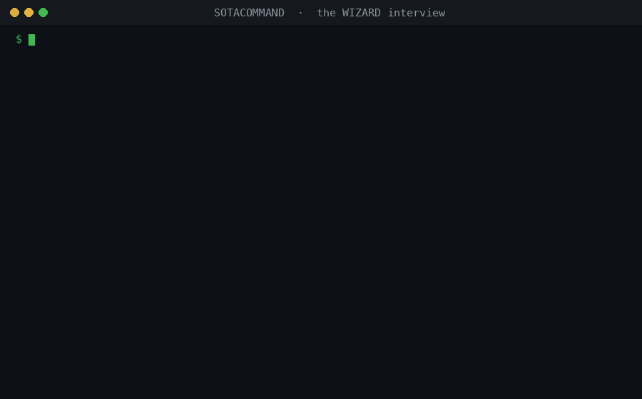

# SOTACOMMAND

Your own team of AI helpers, set up by typing one word: open this folder in any AI tool, type `WIZARD`, answer about ten plain questions about your brand, business or art, and it builds the team, shows you how to use it, and checks that it works.

> [!TIP]
> **New to AI agents? Start here. You don't need to know anything yet.**
> 1. Get this folder: `git clone https://github.com/KevinOrosz/SOTACOMMAND.git` (or the green **Code** button → **Download ZIP**).
> 2. Open the folder in an AI tool: Claude Code, Codex, Cursor, GitHub Copilot, Gemini CLI, Hermes Agent or another.
> 3. Type **`WIZARD`**.
>
> That's it. WIZARD interviews you, builds your team, and walks you through your first job. ([Exactly what it does](WIZARD.md) · [Full guide](START-HERE.md))



*A real run of the interview in a terminal, under a minute. In an AI tool, WIZARD asks the same questions in chat.*

## What happens when you type WIZARD

1. **It interviews you.** About ten questions in everyday words, one at a time: what to call you, the name of your project, what you make and who it's for, what you want help with, how your team should sound, what it must never do, and what always needs your OK.
2. **It helps you pick your helpers.** Each one is explained in one line, and it suggests the set that fits your work.
3. **It builds your team** in a folder you choose, for the tool you use. It shows you every file first and never overwrites anything.
4. **It hands you your team card**, `TEAM.md`: who is on your team, what each helper does for *your* project, and the exact words to say to use it.
5. **It checks everything** and walks you through a first real job.

No AI tool handy? The same interview runs in a terminal:

```bash
python3 tools/wizard/wizard.py install --target ~/my-project
python3 tools/wizard/wizard.py interview --target ~/my-project
```

## Your team

| Helper | What it does for you | It can't |
|---|---|---|
| **The Lead** (`orchestrator`) | Listens to you, hands each job to the right helper, checks the work before you see it | Skip your approval |
| **The Builder** (`builder`) | Writes and fixes code, websites and automations | Touch your real files until you accept its work: it builds in its own copy |
| **The Researcher** (`researcher`) | Looks things up, compares options, writes you a plan | Build or publish |
| **The Time-Keeper** (`owner-auditor`) | Tracks how much of *your* time the team uses, and the one fix that saves the most | Run commands or change your work |
| **The Listener** (`sensor`) | Reads what people say about your work and tells you what they want | Reply, post or log in anywhere |
| **The Writer** (`repurposer`) | Turns one piece you approved into drafts for other places, in your voice | Post or send anything |

You choose which helpers are on. In Claude Code the "can't" column is enforced by the tool itself; in other tools it is a rule the helper follows.

## Two repos, one system

| | What it is | Start it with |
|---|---|---|
| **SOTACOMMAND** (this one) | The team: helpers, their rules, skills and daily routine | `WIZARD` |
| **[SOTASECONDBRAIN](https://github.com/KevinOrosz/SOTASECONDBRAIN)** | The memory: a private notebook your helpers propose pages for and only you approve | `WIZARD` |

Each works alone. Together, your team remembers what it learns for months, not days: [connect them in three steps](integrations/second-brain/README.md).

> **Status: v0.1, early.** The engine, the interview, the skills toolchain, the leak gate, the docs and the eval dashboard are built and tested. What's still open is in [ROADMAP.md](ROADMAP.md).

## TL;DR

- **What:** a ready-made team of six AI agent roles that you set up by interview and drop into any project.
- **Why:** each role can only do its own job, enforced by tool limits rather than polite instructions; skills ship with proof they help; one role measures how much of *your* time the team costs and how to cut it.
- **How:** clone, open in your AI tool, type `WIZARD`.
- **Works with:** any model, any tool. Claude Code gets the strongest enforcement through a plugin; everything else reads `AGENTS.md`.
- **Needs:** Python 3.9+. No accounts, no API keys, no dependencies. The tools make no network calls.
- **Pairs with:** [SOTASECONDBRAIN](https://github.com/KevinOrosz/SOTASECONDBRAIN) for long-term memory.

## Explain it like I'm 10

Imagine you have a group of robot helpers. If they all try to do everything at once, they bump into each other and make a mess. SOTACOMMAND gives each helper **one job and a rulebook it can't break**. A boss helper listens to you and hands each job to the right one. A time-keeper counts how often you had to step in, and tells you the one fix that saves you the most time. They keep a short notebook so tomorrow they remember today.

You don't build any of this. You type `WIZARD`, a friendly helper asks you about yourself and your work, and then it sets up the whole team for you and shows you what to say.

## What your agent team cost you this week

One role on the team, the owner-auditor, has a single job: measuring what the system costs *you*. Each week it reports the time you spent steering the agents, the interventions you had to make, and the one fix that would save you the most.

*Example report with synthetic numbers. The owner-auditor ships with the engine plugin.*

```text
Owner-auditor weekly report                      EXAMPLE: SYNTHETIC NUMBERS

Owner time               3.5 h    down 1.6 h from last week
Interventions            14       6 corrections, 5 approvals, 3 unblocks
Repeat interventions     4        the same correction, asked for again

Where the time went
  Re-explaining the release checklist           1.2 h    3 sessions
  Approving routine dependency updates          0.8 h    5 approvals
  Unblocking a test run that needed a secret    0.5 h    1 session

Top fix
  Turn the release checklist into a skill with a mandatory gate.
  Expected saving: about 1 h a week.

Your decision
  Approve the checklist skill, or keep explaining it by hand.
```

It reports facts and one recommendation, and it leaves the decision with you.

## Try it: five things to say

Once the team is installed in your project, open your agent tool there and say:

| You say | What happens |
|---|---|
| *"Add a dark-mode toggle to the settings page."* | The orchestrator routes it to the builder, which works in an isolated git worktree and hands back the change with its test output. |
| *"Compare three ways to send transactional email and recommend one."* | The researcher returns evidence, a thesis, the strongest counterargument and a build-ready spec. |
| *"Run the owner-auditor for this week."* | You get `memory/owner-ledger.md`: each intervention, its cause, its minutes, and one fix. |
| *"Run convergence on: should we move billing to a new provider?"* | Several independent passes, then one synthesis that lists where they agree and where they contradict. |
| *"Summarize sales.csv into summary.md."* | The `csv-summary` skill writes the row count, column totals and every negative value. |

## Proof, not claims

A skill counts as stable only when it beats having no skill: a with-skill score of at least 0.80 and a Δ of at least +0.20 against a no-skill baseline, over 3 or more runs on a pinned model. A skill that doesn't beat no skill is published as a regression, not hidden.

<!-- proof:start (generated by tools/repo/site/build.py from the committed eval summaries; edit those, not this block) -->

No eval summaries are committed yet, so this section makes no claims. Each skill appears here with its with-skill score and its Δ against a no-skill baseline once its first redacted eval summary is committed.

See the [eval dashboard](site/evals/index.html) and [how a skill qualifies](site/qualify-a-skill.md).

<!-- proof:end -->

## What's inside

| Layer | What you get |
|---|---|
| **Team** | Role contracts with hard boundaries and handoffs: an orchestrator plus researcher, builder, owner-auditor, sensor and repurposer roles. |
| **Skills** | A library with a status lifecycle (experimental, stable, retired) in the open Agent Skills format. Every stable skill ships its eval cases and results. |
| **Memory** | Three tiers with size caps and decay, so each session starts from a small, current context. |
| **Governance** | Routing, pushback, convergence, an audit of the owner's time, and verify-before-done, each backed by a tool or a check. |

Roles declare a capability tier instead of naming a model, and the repository's tools are standard-library Python that make no network calls.

## Install

The easy way is `WIZARD` (above). By hand, from a clone of this repository:

```bash
python3 tools/wizard/wizard.py install --target ~/my-project --harness generic
python3 tools/wizard/wizard.py interview --target ~/my-project
python3 tools/wizard/wizard.py check --target ~/my-project
```

### Claude Code

From GitHub:

```bash
claude plugin marketplace add KevinOrosz/SOTACOMMAND
claude plugin install sotacommand-engine@sotacommand
```

The first command adds this repository as a plugin marketplace; the second installs the engine plugin from it. From a local clone, `claude plugin marketplace add ./` works the same way. Start a new session in your project: it runs as the orchestrator.

### Codex

Codex reads `AGENTS.md` and the skills in `.agents/skills/`. The installer writes both:

```bash
python3 tools/wizard/wizard.py install --target ~/my-project --harness codex
```

GitHub Copilot (`--harness copilot`), Cursor (`--harness cursor`), Gemini CLI (`--harness gemini`), Hermes Agent (`--harness hermes`), any chat assistant (`--harness flat`) and any other tool (`--harness generic`) are covered in [Harnesses](site/harnesses.md) and [START-HERE.md](START-HERE.md). `wizard.py uninstall` takes it all out again and keeps every file you changed.

## Docs

- [START-HERE.md](START-HERE.md): the full guide, for people and for agents
- [Overview](site/index.md): what this is and why it's built this way
- [Quickstart](site/quickstart.md): from clone to first task
- [Concepts](site/concepts.md): team, skills, memory and governance, with a diagram each
- [Harnesses](site/harnesses.md): Claude Code, Codex, GitHub Copilot, Cursor, Gemini CLI, Hermes Agent and any other tool
- [Second brain](integrations/second-brain/README.md): connect a SOTASECONDBRAIN knowledge base as long-term memory
- [Qualify a skill](site/qualify-a-skill.md): the stable rule, and how to run the evals with a no-skill baseline
- [FAQ](site/faq.md)
- [Eval dashboard](site/evals/index.html): every measured skill's score and Δ
- [ROADMAP.md](ROADMAP.md): known gaps and what's next
- For agents: [AGENTS.md](AGENTS.md), [llms.txt](site/llms.txt) and [llms-full.txt](site/llms-full.txt)

## Contributing

Skill proposals, harness support and fixes are welcome. Read [CONTRIBUTING.md](CONTRIBUTING.md) first: it covers proposing a skill, the stable rule, and running the checks locally. Report security problems privately, as [SECURITY.md](SECURITY.md) describes.

## License

Apache-2.0. See [LICENSE](LICENSE) and [NOTICE](NOTICE). Forks and redistributions keep the NOTICE attribution.

<!-- cta -->
